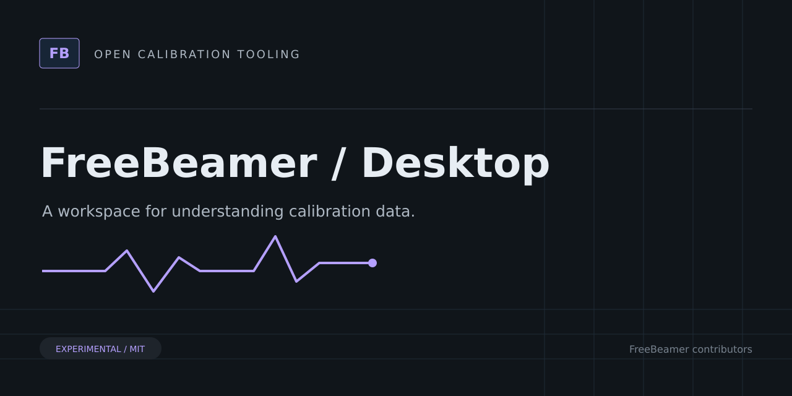
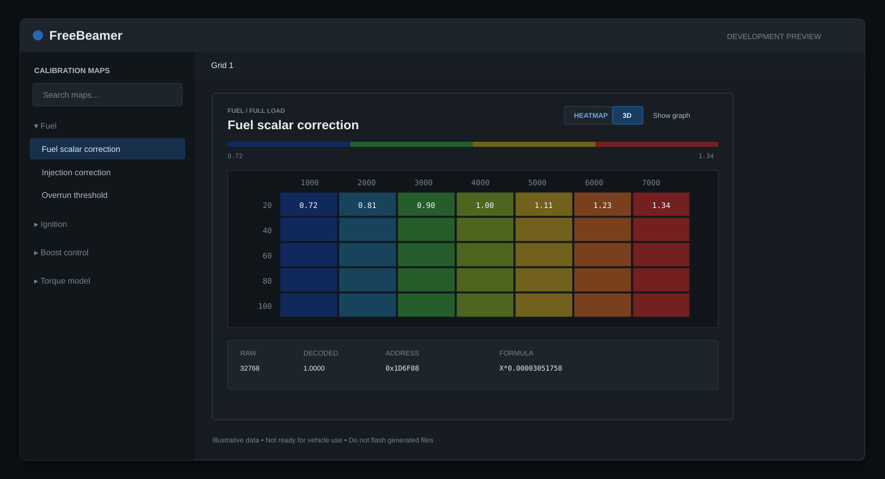
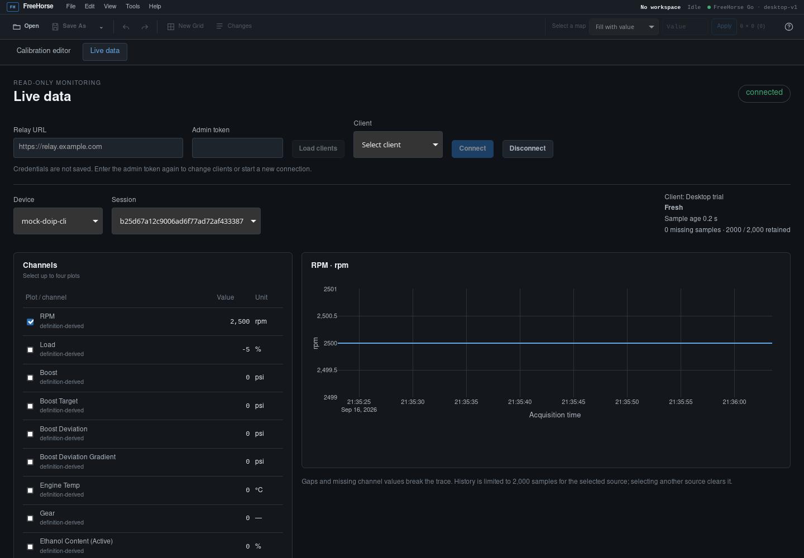

# FreeBeamer Desktop



Experimental ECU calibration editor and live-data viewer built with Go, Wails, Angular, and Plotly.

> [!WARNING]
> Experimental software. Not validated for vehicle use. Do not flash files produced by FreeBeamer.

Wails hosts the Angular calibration workspace and live-data viewer. The UI provides editable tables, line/heatmap/3D views, undo/redo, diff review, and guarded Save As. Live-data sources and vehicle-profile bindings remain experimental.





Install the Go version in `go.mod`, Node.js 24, and Wails v2.15.0. On Linux, install the Wails GTK3/WebKitGTK development prerequisites; `webkit2_41` is for WebKitGTK 4.1. See the [official Wails prerequisites](https://wails.io/docs/gettingstarted/installation).

## Development

```sh
npm --prefix frontend ci
npm --prefix frontend run test:ci
npm --prefix frontend run build
go test ./internal/desktop/...
wails build -tags webkit2_41
```

## Related projects

- [Core](https://github.com/freebeamer/core) — Go libraries for ECU calibration formats, binary editing, checksums, vehicle profiles, and telemetry contracts.
- [CLI](https://github.com/freebeamer/cli) — Command-line tools for inspecting calibration files, reviewing binary changes, verifying checksums, and collecting experimental live data.
- [Relay](https://github.com/freebeamer/relay) — Self-hosted Go telemetry relay with authenticated ingestion, SQLite storage, session history, and WebSocket live feeds.
- [Mobile](https://github.com/freebeamer/mobile) — Experimental Flutter companion for read-only MHD/ENET live-data acquisition and upload to a FreeBeamer telemetry relay.

## Contributing and license

See [CONTRIBUTING.md](CONTRIBUTING.md). Source and original artwork are licensed under [MIT](LICENSE). Do not submit proprietary firmware, customer files, secrets, or identifying vehicle data.
